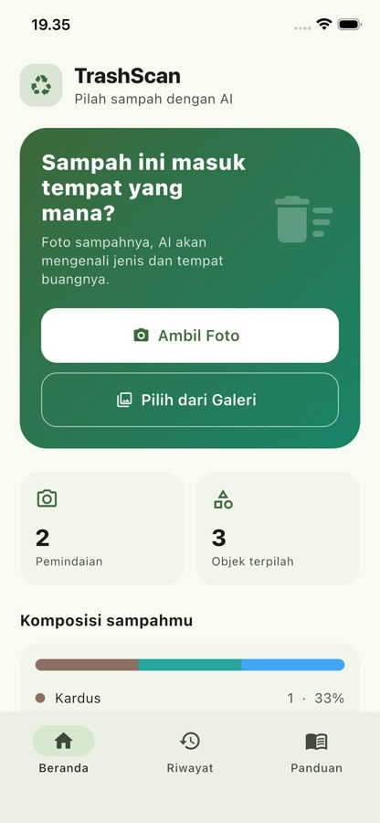
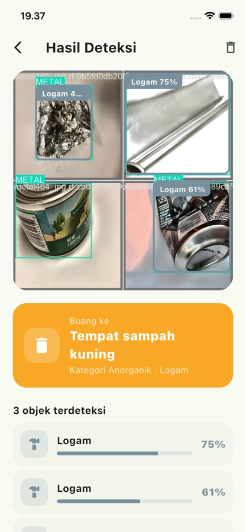
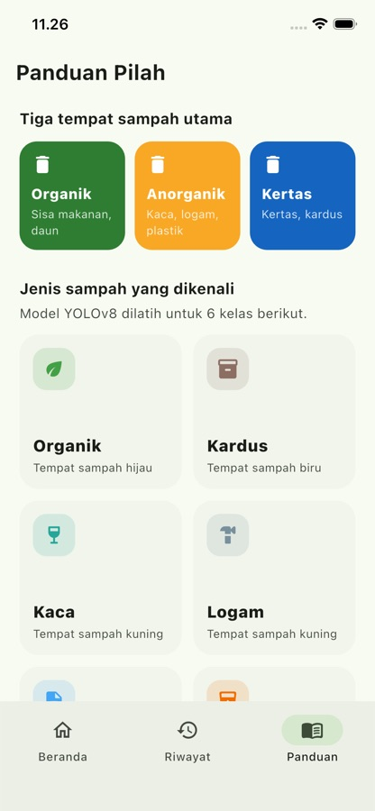

# Trash Classification · TrashScan

Detect and sort household waste with **YOLOv8**, from dataset preprocessing and model training in Python to **TrashScan**, a Flutter mobile app that runs the model **on-device and offline**.

<p align="center">
  
  &nbsp;
  
  &nbsp;
  
</p>

## Features

- **Snap or pick a photo**: take a picture with the camera or choose one from the gallery.
- **On-device detection**: YOLOv8 runs locally through TensorFlow Lite. No server or internet connection is needed.
- **Where does it go?**: each detection is mapped to a bin using Indonesia's colour-coded sorting system.
- **Bounding boxes and confidence scores**: tap an item to highlight it on the photo.
- **Disposal tips**: practical handling tips and decomposition time for every class.
- **Scan history and statistics**: past scans are stored on the device, with a breakdown of what you've sorted.
- **Sorting guide**: a reference page for all classes and bins.
- **Light and dark mode** with Material 3.

The app UI is in Bahasa Indonesia.

## Classes

The model recognises 6 waste classes:

| Class | App label | Bin |
|---|---|---|
| `BIODEGRADABLE` | Organik | 🟢 Green (organic) |
| `CARDBOARD` | Kardus | 🔵 Blue (paper) |
| `GLASS` | Kaca | 🟡 Yellow (inorganic) |
| `METAL` | Logam | 🟡 Yellow (inorganic) |
| `PAPER` | Kertas | 🔵 Blue (paper) |
| `PLASTIC` | Plastik | 🟡 Yellow (inorganic) |

## Model

Several YOLOv8 variants (s / m / l) were trained on a class-balanced dataset. Two image-enhancement strategies were also tried: **CLAHE** contrast enhancement and **Real-ESRGAN x4** super-resolution.

The app uses **YOLOv8m trained on the balanced dataset**. It scored about the same as the larger YOLOv8l while being roughly 40% smaller:

| Metric (validation) | Value |
|---|---|
| Precision | 0.748 |
| Recall | 0.599 |
| mAP@50 | 0.683 |
| mAP@50-95 | 0.489 |
| Size (TFLite fp16) | ~49 MB |

The Real-ESRGAN run scored slightly higher (mAP@50-95 0.501), but it was validated on enhanced images, while the app receives unprocessed camera photos.

## Project structure

```
Trash-Classification/
├── preprocessing.py              # CLAHE (+ optional Real-ESRGAN) preprocessing
├── clahe.py                      # Apply CLAHE to a dataset
├── enhance_dataset_realesrgan.py # Real-ESRGAN x4 dataset enhancement
├── setup_realesrgan_dataset.py   # Build the enhanced dataset structure
├── negative_preprocessing.py     # Prepare negative (background) samples
├── data_augmentation.py          # Data augmentation
├── count_class.py                # Class distribution per split
├── analyze_with_negative.py      # Dataset analysis incl. negatives
├── visualize_data.py             # Visualise labels
├── trainingnew.py                # Train YOLOv8 (Real-ESRGAN dataset)
├── data_train_clahe.py           # Train YOLOv8 (CLAHE dataset)
├── class_weights.txt             # Class weights for imbalance
├── trash_detect.py               # Batch inference on a folder of images
├── live_detection.py             # Real-time webcam detection (OpenCV)
└── mobile_app/                   # TrashScan Flutter app
    ├── lib/
    │   ├── models/               # Waste classes, scan results
    │   ├── services/             # TFLite detector + YOLOv8 post-processing
    │   ├── state/                # App state and history storage
    │   ├── screens/              # Home, result, history, guide
    │   └── widgets/              # Detection overlay
    ├── tools/export_tflite.py    # best.pt → TFLite export script
    ├── assets/models/            # Place the .tflite model here
    └── test/                     # Unit tests
```

## Getting started

### 1. Train or reuse a model (Python)

```bash
pip install ultralytics
python trainingnew.py           # or data_train_clahe.py
python live_detection.py        # quick webcam test
```

### 2. Export the model for the app

Trained weights and `.tflite` files are not committed (see `.gitignore`). Export your `best.pt` with **Python ≥ 3.10**:

```bash
pip install ultralytics tensorflow onnx2tf onnxscript
python mobile_app/tools/export_tflite.py path/to/best.pt --half
```

This writes `mobile_app/assets/models/trash_yolov8.tflite` and warns you if the model's class order doesn't match the app.

### 3. Run the app

```bash
cd mobile_app
flutter pub get
flutter run
```

Without a model file the app starts in **demo mode**: every screen works, but detections are random.

> **iOS 26+ devices:** use a recent Flutter release. Older versions crash in debug mode on newer iOS; `flutter run --release` works as a fallback.

### Tests

```bash
cd mobile_app && flutter test
```

## How the app runs the model

1. The photo is decoded, rotated using its EXIF data, and saved to the scan history.
2. It is **letterboxed** to 640×640 with grey padding (114), matching Ultralytics training.
3. The TFLite model runs in a **background isolate** so the UI stays responsive.
4. The raw `[1, 10, 8400]` output is decoded in Dart. Boxes are mapped back to the original image and filtered with **per-class NMS**.

## Tech stack

- **ML:** Python, Ultralytics YOLOv8, PyTorch, OpenCV, CLAHE, Real-ESRGAN
- **Mobile:** Flutter / Dart, `tflite_flutter`, `image_picker`, `image`, `shared_preferences`
